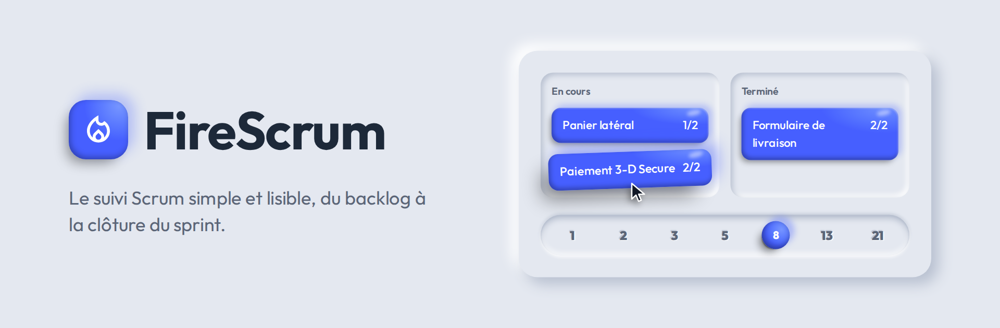
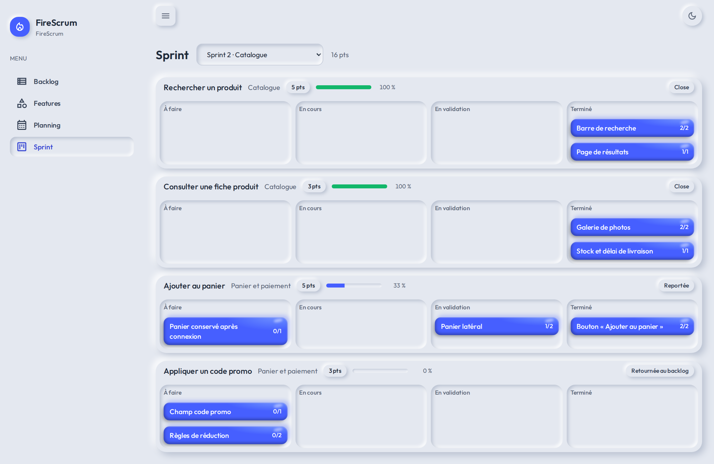
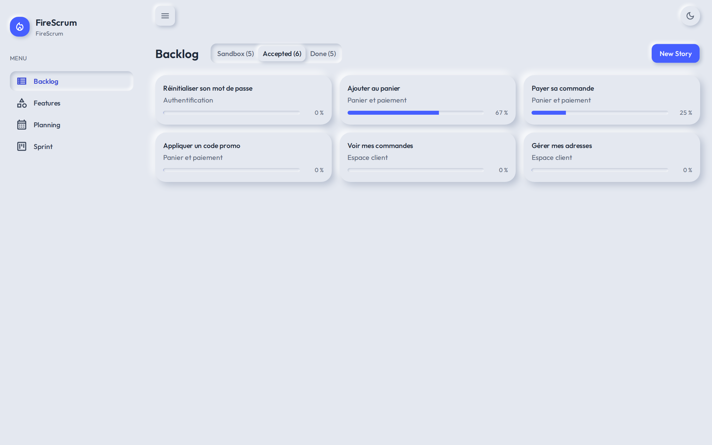
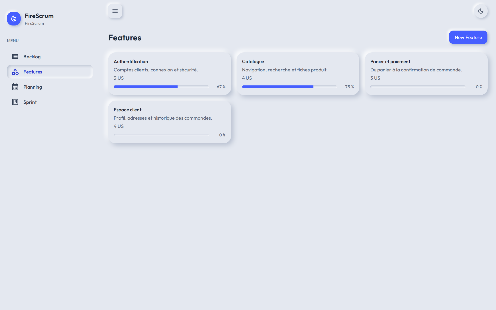
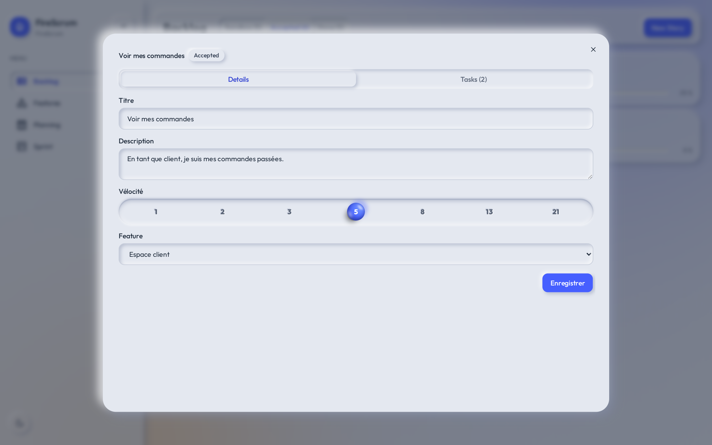
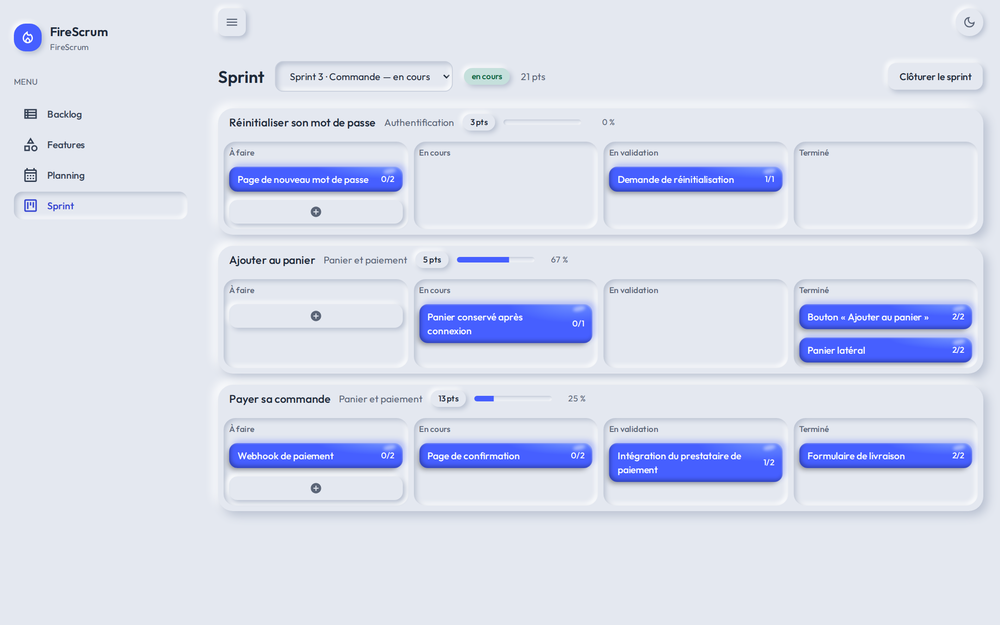

<p align="center">
  <picture>
    <source media="(prefers-color-scheme: dark)" srcset="docs/images/banner-dark.png" />
    
  </picture>
</p>

<p align="center">
  
  
  
  
</p>

<h3 align="center">Organisez, avancez, livrez. Sans rien configurer.</h3>

<p align="center">
  FireScrum range le travail de l'équipe en <b>features</b>, <b>user stories</b> et <b>tâches</b>,<br />
  et montre l'avancement réel, sprint après sprint, dans une interface douce et tactile.
</p>

<p align="center">
  <a href="#-démarrer-en-2-minutes"><b>Démarrer</b></a> ·
  <a href="#-en-images"><b>Captures</b></a> ·
  <a href="#-comment-ça-marche"><b>Fonctionnement</b></a> ·
  <a href="docs/specs/README.md"><b>Fonctionnalités livrées</b></a>
</p>

<br />

<picture>
  <source media="(prefers-color-scheme: dark)" srcset="docs/images/sprint-closed-dark.png" />
  
</picture>

## ✨ Pourquoi FireScrum

<table>
  <tr>
    <td width="50%" valign="top">
      <h4>📊 L'avancement, d'un coup d'œil</h4>
      Chaque story et chaque feature a sa barre de progression, calculée à partir du travail réellement terminé. Pas de pourcentage saisi à la main.
    </td>
    <td width="50%" valign="top">
      <h4>✅ Une qualité vérifiée, pas déclarée</h4>
      Une tâche ne passe en « Terminé » que lorsque tous ses critères de validation sont cochés. Le serveur y veille, pas seulement l'écran.
    </td>
  </tr>
  <tr>
    <td width="50%" valign="top">
      <h4>🏁 Des sprints maîtrisés</h4>
      À la clôture, le Product Owner décide du sort de chaque story : close, reportée au sprint suivant ou renvoyée au backlog.
    </td>
    <td width="50%" valign="top">
      <h4>🗂️ Un historique fiable</h4>
      Les sprints passés restent consultables tels qu'à leur clôture, et une story terminée ne se modifie plus.
    </td>
  </tr>
  <tr>
    <td width="50%" valign="top">
      <h4>🖐️ Agréable à manipuler</h4>
      Les tâches glissent de colonne en colonne, la vélocité se choisit en faisant rouler une bille. Le style neumorphique donne du relief à chaque élément.
    </td>
    <td width="50%" valign="top">
      <h4>🌗 Clair ou sombre, partout</h4>
      Un mode sombre calibré, des contrastes AA, un focus visible au clavier, et une interface qui s'adapte au mobile.
    </td>
  </tr>
</table>

## 🖼️ En images

<table>
  <tr>
    <td width="50%" valign="top">
      <picture>
        <source media="(prefers-color-scheme: dark)" srcset="docs/images/backlog-dark.png" />
        
      </picture>
      <p align="center"><b>Backlog</b> : les stories à valider, acceptées et terminées.</p>
    </td>
    <td width="50%" valign="top">
      <picture>
        <source media="(prefers-color-scheme: dark)" srcset="docs/images/features-dark.png" />
        
      </picture>
      <p align="center"><b>Features</b> : les stories regroupées par thème, avec leur avancement.</p>
    </td>
  </tr>
  <tr>
    <td width="50%" valign="top">
      <picture>
        <source media="(prefers-color-scheme: dark)" srcset="docs/images/story-dark.png" />
        
      </picture>
      <p align="center"><b>Story</b> : titre, description, feature, et la vélocité choisie à la bille.</p>
    </td>
    <td width="50%" valign="top">
      <picture>
        <source media="(prefers-color-scheme: dark)" srcset="docs/images/sprint-dark.png" />
        
      </picture>
      <p align="center"><b>Sprint</b> : les tâches glissent de « À faire » à « Terminé ».</p>
    </td>
  </tr>
</table>

<p align="center"><sub>Les captures suivent le thème de votre GitHub : passez-le en sombre pour voir l'autre version.</sub></p>

## 🔄 Comment ça marche

```
Projet
 ├─ Feature        un ensemble cohérent de stories, avec son avancement
 └─ User Story     un besoin, estimé en points (suite de Fibonacci)
     └─ Tâche      le travail à faire, avec ses critères de validation
```

| | Étape | Ce qui se passe |
|:-:|---|---|
| **1** | **Capturer** | Les nouvelles stories arrivent dans le *Backlog*, à valider par le Product Owner. |
| **2** | **Regrouper** | La page *Features* rassemble les stories par thème, avec une recherche rapide. |
| **3** | **Lancer** | On choisit les stories validées ; la vélocité totale du sprint s'affiche. |
| **4** | **Avancer** | Les tâches glissent de colonne en colonne : À faire, En cours, En validation, Terminé. |
| **5** | **Clôturer** | Chaque story est close, reportée ou renvoyée au backlog, et le sprint est archivé. |

## 🧭 Les pages

| Page | À quoi elle sert |
|------|------------------|
| **Backlog** | Créer les stories et leurs tâches, les valider. Trois onglets : à valider, acceptées, terminées. |
| **Features** | Regrouper les stories et suivre l'avancement de chaque feature. Chaque story y affiche son statut : en attente, planifiée, en cours ou terminée. |
| **Sprint** | Lancer, suivre et clôturer les sprints ; consulter les sprints passés. |
| **Planning** | Calendrier des sprints (à venir). |

## 🗺️ Feuille de route

- [x] **Aujourd'hui** : un projet, le cycle complet backlog → sprint → clôture, et le suivi de l'avancement.
- [ ] **Ensuite** : plusieurs utilisateurs, avec des rôles *Product Owner* et *Développeur*, et le calendrier des sprints.
- [ ] **Plus tard** : l'authentification et la gestion de plusieurs projets.

## 🚀 Démarrer en 2 minutes

**Prérequis**

- [Docker](https://docs.docker.com/get-docker/) avec Docker Compose
- [`just`](https://github.com/casey/just) (`sudo apt install just`, `brew install just` ou `cargo install just`)
- [Node](https://nodejs.org/) 24 : seulement pour les types des tests dans l'IDE

```bash
cp .env.template .env   # identifiants et ports, à adapter
just dev                # http://localhost:4200
just tests              # tous les tests, sur une stack à part
```

## 📚 Pour aller plus loin

- [Vision du produit](docs/idee-projet.md)
- [Fonctionnalités livrées](docs/specs/README.md)
- [Cahier de recettes](docs/cahier-de-recettes.md)
- [Documentation technique](docs/stack.md)
