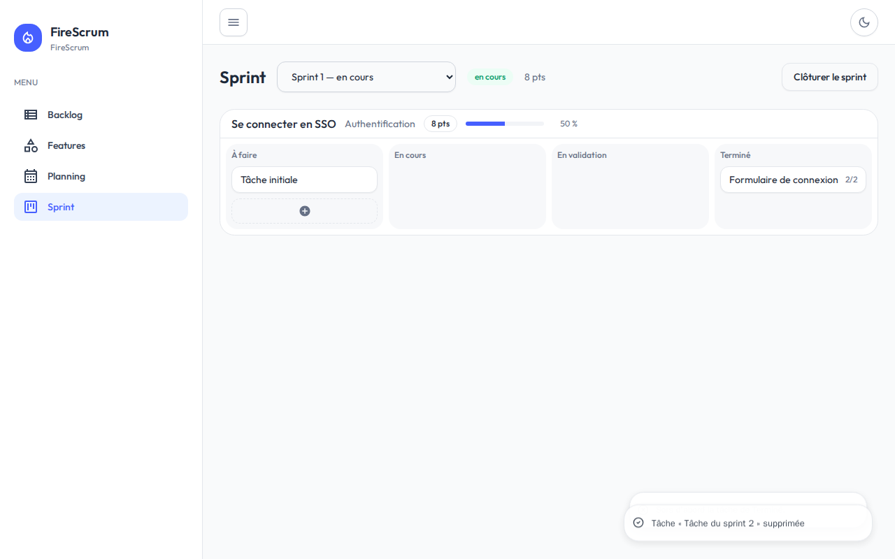
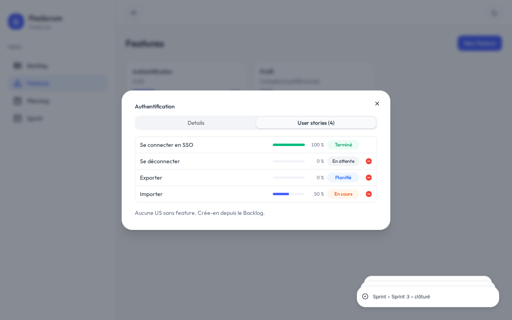

# FireScrum

**Le suivi Scrum, simple et lisible, du backlog à la clôture du sprint.**

FireScrum aide une équipe à organiser son travail en *features*, *user stories* et *tâches*, et à suivre leur avancement sprint après sprint. L'outil reste volontairement épuré : il couvre l'essentiel du cycle Scrum, sans configuration à faire avant de commencer.



## Pourquoi FireScrum

- **Une vue claire de l'avancement.** Chaque user story et chaque feature affiche sa barre de progression, calculée automatiquement à partir du travail réellement terminé.
- **Une qualité vérifiée, pas seulement déclarée.** Une tâche ne passe en « Terminé » que lorsque tous ses critères de validation sont cochés.
- **Des sprints maîtrisés.** À la clôture, le Product Owner décide du sort de chaque story : close, reportée au sprint suivant, ou renvoyée au backlog. Les sprints passés restent consultables tels qu'ils étaient à leur clôture.
- **Un historique fiable.** Une story terminée ne se modifie plus, et ne peut plus être retirée de sa feature.

## Comment ça marche

```
Projet
 ├─ Feature        un ensemble cohérent de stories, avec son avancement
 └─ User Story     un besoin, estimé en points (suite de Fibonacci)
     └─ Tâche      le travail à faire, avec ses critères de validation
```

1. **Capturer les besoins** : les nouvelles stories arrivent dans le *Backlog*, à valider par le Product Owner.
2. **Les regrouper** : la page *Features* rassemble les stories par thème, avec une recherche rapide.
3. **Lancer un sprint** : on choisit les stories validées ; la vélocité totale du sprint s'affiche.
4. **Avancer au quotidien** : les tâches glissent de colonne en colonne : À faire, En cours, En validation, Terminé.
5. **Clôturer** : chaque story est close, reportée ou renvoyée au backlog, et le sprint est archivé.



## Les pages

| Page | À quoi elle sert |
|------|------------------|
| **Backlog** | Créer les stories et leurs tâches, les valider. Trois onglets : à valider, acceptées, terminées. |
| **Features** | Regrouper les stories et suivre l'avancement de chaque feature. Chaque story y affiche son statut : en attente, planifiée, en cours ou terminée. |
| **Sprint** | Lancer, suivre et clôturer les sprints ; consulter les sprints passés. |
| **Planning** | Calendrier des sprints (à venir). |

L'interface s'adapte au mobile et propose un mode sombre.

## Feuille de route

- **Aujourd'hui** : un projet, le cycle complet backlog → sprint → clôture, et le suivi de l'avancement.
- **Ensuite** : plusieurs utilisateurs, avec des rôles *Product Owner* et *Développeur*, et le calendrier des sprints.
- **Plus tard** : l'authentification et la gestion de plusieurs projets.

## Pour aller plus loin

- [Vision du produit](docs/idee-projet.md)
- [Fonctionnalités livrées](docs/specs/README.md)
- [Cahier de recettes](docs/cahier-de-recettes.md)
- [Documentation technique](docs/stack.md)
