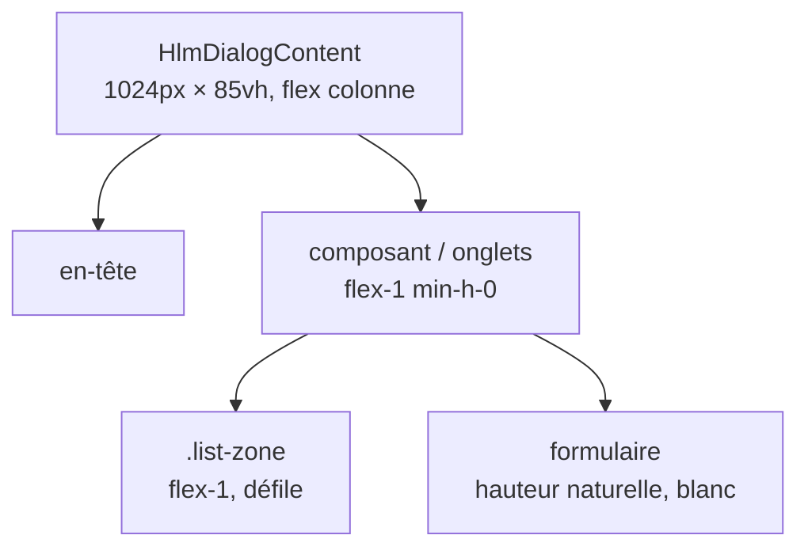

# 009 — Plan

Supprimé à la livraison : reporter d'abord les décisions utiles dans `spec.md`.

## Approche

- **Taille dans le défaut de `HlmDialogContent`** (`libs/ui/dialog/src/lib/hlm-dialog-content.ts`) : `sm:max-w-5xl h-[85vh]`, mise en page en colonne flex (au lieu de `grid`), avec `overflow-y-auto` en dernier recours sur téléphone. On retire les `sm:max-w-*` posés sur les 7 modals. Écarté : répéter la classe sur chaque modal (risque d'oubli sur une future modal).
- **Classe CSS `.list-zone`** dans `src/styles.css` (`@layer components`, à côté de `.select`) : fond `--muted`, bordure, coins arrondis, `flex: 1; min-height: 0; overflow-y: auto`. Écarté : composant ou directive Angular, trop lourd pour du style sans logique.
- **Chaîne flex jusqu'à la zone** : chaque niveau entre la modal et la zone (composant hôte, `hlm-tabs`, contenu d'onglet) devient `flex flex-col flex-1 min-h-0`, sinon la zone ne peut pas remplir l'espace restant ni défiler. Le formulaire garde sa hauteur naturelle, sur fond blanc.
- **Onglets de la tâche du sprint** : `hlm-tabs` piloté par un signal `tab`, comme la modal d'US du backlog. Le contenu de la modal est recréé à chaque ouverture, donc l'onglet repart sur « Points de validation ».

## Impacts

- **Base** : aucun.
- **API** : aucune.
- **Contrats** : aucun.
- **Front** : `libs/ui/dialog` (contenu de modal), `styles.css`, les 4 pages qui ouvrent des modals, les modals feature, US, tâche du sprint, lancement et clôture ; parcours navigateur `tests/e2e/pages.mjs`.

## Tâches

Courtes, dans l'ordre : le code s'arrête après chaque tâche pour validation.

- [x] **T1 — Taille commune des modals** : défaut de `HlmDialogContent` (1024 px × 85vh, colonne flex, défilement de secours) ; retrait des `sm:max-w-*` dans `features/template.html`, `backlog/template.html`, `sprint/template.html`, `sprint/forms/user-story/template.html`.
  → vérif : lint + build + `scripts/test.sh` (parcours navigateur).
  → à regarder : ouvrir chaque modal, elles ont toutes la même taille ; en largeur téléphone (DevTools), la modal tient dans l'écran.
- [x] **T2 — Zone grise et onglet Tasks de l'US** : classe `.list-zone` dans `styles.css` ; chaîne flex et zone sur la liste des tâches dans `backlog/forms/user-story/` (template + hôte du composant), formulaire en dessous.
  → vérif : lint + build + parcours navigateur.
  → à regarder : Backlog › une US › Tasks, ajouter une dizaine de tâches : la liste défile, le formulaire reste visible, la modal ne bouge pas.
- [x] **T3 — Onglet User stories de la feature** : deux zones moitié-moitié (US de la feature, résultats de recherche) ; la liste de la feature prend tout quand il n'y a aucune US sans feature (`features/forms/feature/`).
  → vérif : lint + build + parcours navigateur.
  → à regarder : Features › une feature › User stories, avec et sans US sans feature.
- [x] **T4 — Lancer et clôturer un sprint** : liste des US acceptées dans la zone (`sprint/forms/launch/`) ; tableau dans la zone, en-tête figé (`sticky`), message « Aucune US dans ce sprint. » (`sprint/forms/close/`).
  → vérif : lint + build + parcours navigateur.
  → à regarder : Sprint › « Nouveau sprint » et « Clôturer le sprint » avec beaucoup d'US : défilement, en-tête et bouton visibles.
- [x] **T5 — Onglets de la tâche du sprint** : onglets « Points de validation (n) » (par défaut) et « Details » (description dans la zone en lecture seule, formulaire sinon) ; à la création, pas d'onglets, zone « Pas encore de points de validation » et formulaire en dessous (`sprint/forms/task/`).
  → vérif : lint + build + parcours navigateur.
  → à regarder : Sprint › cliquer sur une tâche (sprint en cours et sprint clos), puis sur la carte « + ».
- [x] **T6 — Parcours navigateur** : `tests/e2e/pages.mjs`, ouvrir l'onglet Details avant de modifier une tâche du sprint (R12c, R19) ; nouvelles vérifications R49 (même taille pour toutes les modals), R54 (onglets de la tâche, création sans onglets).
  → vérif : `scripts/test.sh` entièrement vert.
  → à regarder : la sortie OK/KO et les captures dans `tests/e2e/screenshots/`.
- [ ] **T7 — Cahier de recettes** : ajout de R49 à R55 (nouvelle section « Modals » du lot 1), R15 modifiée (onglet « Points de validation »).
  → vérif : relecture.
  → à regarder : `docs/cahier-de-recettes.md`.
