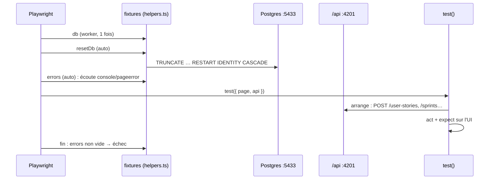
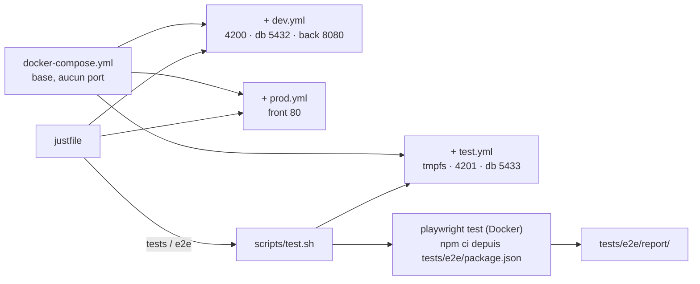

# 010 — Plan

Supprimé à la livraison : reporter d'abord les décisions utiles dans `spec.md`.

## Approche

**Fixtures Playwright (injection de dépendances / inversion de contrôle)** : `helpers.ts` exporte un `test` étendu par `base.extend`, et les specs l'importent par `import { test, expect } from '../helpers'`. Cette extension fournit :

- `db` : client `pg` de portée *worker*, connecté à `127.0.0.1:5433` avec les identifiants du `.env` transmis au conteneur ;
- `resetDb` : fixture *auto*, qui lance `TRUNCATE feature, user_story, task, validation_point, sprint, sprint_user_story RESTART IDENTITY CASCADE` avant chaque test ;
- `errors` : fixture *auto*, qui écoute `pageerror` et `console`, ignore les messages `status of (400|404|409)`, et fait échouer le test si la liste n'est pas vide à la fin ;
- `api` : client basé sur la fixture `request`, qui lève une erreur si la réponse n'est pas OK.

**Fonctions de localisation** : `dialog(page)`, `card(page, title)`, `nav(page, name)`, `row(page, us)`, `column(page, us, label)`, `taskCard(page, us, title)`, `drag(page, us, task, to)`, `expectModalSize(page)`. On écarte les page objects : il faudrait environ 5 classes pour une quarantaine de tests.

**Fonctions fabriques pour les données de départ**, qui suivent directement les routes de l'API :

- `createFeature(api, title, opts)` ;
- `createStory(api, title, { velocity, featureId, tasks, accepted })` ;
- `addTask(api, storyId, { title, validation_points })` ;
- `startSprint(api, name, storyIds)` ;
- `closeSprint(api, id, { closed, carried })` ;
- `setTaskStatus(api, id, status)` ;
- `checkPoint(api, id)`.

On écarte le Builder chaîné : ce serait un petit langage à maintenir pour 7 routes.

**Environnements Compose par fichiers d'override** (et non des `profiles`, qui ne changent pas les ports d'un service) :

Le **`justfile`** sert de point d'entrée unique et reste mince : la logique de test reste dans `scripts/test.sh`. `test.sh` accepte `e2e -- <args>` et transmet `<args>` à `npx playwright test`.

**Pendant la migration**, l'ancien script reste lançable sous le nom de suite `e2e-legacy`, pour ne perdre aucune couverture tant que tous les tests ne sont pas portés. Il est supprimé à la dernière tâche de code.

## Impacts

- **Base** : aucun changement de schéma. Le port 5433 n'est publié que pour la stack de test.
- **API** : aucun changement.
- **Contrats** : aucun changement.
- **Front** : aucun changement.
- **Outillage** :
  - fichiers `docker-compose*.yml` ;
  - `justfile` (nouveau) ;
  - `scripts/test.sh` ;
  - `tests/e2e/` ;
  - `.gitignore` ;
  - docs : `README.md`, `docs/stack.md`, `docs/cahier-de-recettes.md`, `docs/specs/README.md`.

## Tâches

Courtes, dans l'ordre : le code s'arrête après chaque tâche pour validation.

- [x] **T1 — Environnements Compose et `justfile`** : ports génériques (`FRONTEND_PORT`, `BACKEND_PORT`, `DB_PORT`) lus dans le `.env` de chaque machine (modèle `.env.template`). `docker-compose.yml` est la base et la prod (front seul publié). `docker-compose.dev.yml` ouvre la db et le backend sur 127.0.0.1. `docker-compose.test.yml` ouvre la db, et `test.sh` impose 4201 et 5443. Le `justfile` contient `dev`, `prod`, `down`, `tests` et `e2e`.
  → vérif : `just dev` répond sur 4200, avec la base `./data` intacte ; `psql` et `curl` fonctionnent sur `127.0.0.1:5432` et `:8080` ; `just tests` passe avec l'ancien script.
  → à regarder : les 4 fichiers Compose et le `justfile`.
- [x] **T2 — Socle Playwright et `layout/style.spec.ts`** :
  - `tests/e2e/package.json` et son lockfile (`@playwright/test@1.64.1`, `pg`) ;
  - `playwright.config.ts` ;
  - `helpers.ts`, avec les fixtures et les fonctions de localisation ;
  - `test.sh` : suite `e2e` (lancée par `npx playwright test`, avec les options transmises) et suite `e2e-legacy` (l'ancien script) ;
  - `.gitignore` : `report/`, `test-results/` et `node_modules/` ;
  - premiers tests portés : R40, R41, R42, R43, R44 et la page Planning (aucune donnée de départ).

  → vérif : `just e2e` est vert ; `just e2e --grep R43` lance un seul test ; une erreur console provoquée exprès fait échouer le test.
  → à regarder : `helpers.ts` (fixtures) et le rapport `tests/e2e/report/index.html`.
- [x] **T3 — Fabriques et `user-story/`** : on ajoute les fabriques à `helpers.ts`, puis `user-story/logic.spec.ts` (backlog vide, R03 ×2, R03c ×3, R07, R46) et `user-story/rules.spec.ts` (R03d, R03 titre blanc).
  → vérif : `just e2e user-story/` est vert, deux fois de suite.
  → à regarder : les données de départ de chaque test, qui doivent être lisibles d'un coup d'œil.
- [x] **T4 — `feature/`** : `logic.spec.ts` (R02, R02c, R03b ×4, R03f, R47) et `rules.spec.ts` (R03g).
  → vérif : `just e2e feature/` est vert.
  → à regarder : R03f, dont les données de départ couvrent les 4 statuts d'US.
- [x] **T5 — `task/`** : `logic.spec.ts` (R05, R05b ×2, R05c, R12, R12b, R12c, R54) et `rules.spec.ts` (R14, R15, R15b).
  → vérif : `just e2e task/` est vert.
  → à regarder : `drag()` et les tests de glisser-déposer.
- [x] **T6 — `sprint/`** : `logic.spec.ts` (R08, R09, R10, R11, R16, R16b, R17 ×2, R17b, R18, R19, R48) et `rules.spec.ts` (lancement bloqué sans US).
  → vérif : `just e2e sprint/` est vert, seul.
  → à regarder : R18 et R19, qui étaient les plus chaînés.
- [x] **T7 — R49 dans `layout/style.spec.ts`** : toutes les modals font la même taille, à partir de données créées par les fabriques.
  → vérif : `just e2e --grep R49` lance seulement R49, qui est vert.
  → à regarder : la liste des 7 modals vérifiées.
- [x] **T8 — Suppression de l'ancien script** : on supprime `pages.mjs` et la suite `e2e-legacy`, on retire `screenshots/` de `.gitignore`, et on compare les IDs de l'ancien script avec les titres des nouveaux tests.
  → vérif :
  - `just tests` est vert (R56) ;
  - la liste des IDs est identique ;
  - un test cassé exprès apparaît dans le rapport avec sa trace (R59) ;
  - la stack de travail est inchangée (R60).

  → à regarder : la comparaison des IDs.
- [x] **T9 — Docs** :
  - `README.md` : nouvelle section Prérequis (Docker avec Compose, `just`, Node) ;
  - `docs/stack.md` : « Lancer le projet » passe à `just dev`, on y met les ports par environnement et une section Tests ;
  - `docs/cahier-de-recettes.md` : section Outillage, R56 à R61 ;
  - `docs/specs/README.md` : ligne 010.

  → vérif : chaque commande citée dans la doc fonctionne.
  → à regarder : les sections Prérequis et Lancer le projet.
