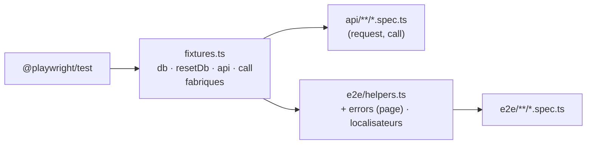
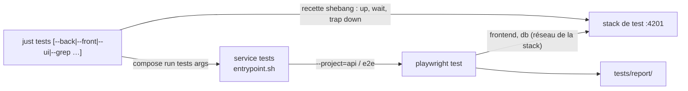

# 011 — Plan

Supprimé à la livraison : reporter d'abord les décisions utiles dans `spec.md`.

## Approche

**Fixtures en deux couches** (mécanisme `base.extend`, déjà utilisé) :

- `tests/fixtures.ts` étend `@playwright/test` avec :
  - `db` : portée worker ;
  - `resetDb` : automatique ;
  - `api` : prépare les données et lève une erreur si la réponse n'est pas OK ;
  - **`call`** : nouvelle, renvoie la réponse brute pour vérifier un 400, un 404 ou un 409.

  Il exporte aussi les fabriques (`createFeature`, `createStory`, `startSprint`, `closeSprint`, `setTaskStatus`, `checkPoint`). Les projets api et e2e s'en servent tous les deux.
- `tests/e2e/helpers.ts` étend à son tour le `test` de `fixtures.ts`. Il ajoute la fixture `errors` (console, automatique, dépend de `page`) et les localisateurs (`dialog`, `card`, `drag`, `expectModalSize`…). Il réexporte tout, donc les specs e2e gardent `import … from '../helpers'`.



`api` et `call` ont la même signature, `(method, path, data?)`, et partagent le préfixe `/api` :

```ts
await api('POST', '/user-stories', {...})                 // arrange: throws if not OK
expect((await call('POST', '/features', { title: ' ' })).status(), 'titre vide refusé').toBe(400)
```

**Projets Playwright** : `api` (`testDir: 'api'`, sans navigateur) et `e2e` (`testDir: 'e2e'`, viewport 1280 × 800). Un seul run donne un seul rapport (`tests/report/`).

**Lanceur** : `tests/Dockerfile` et `tests/entrypoint.sh`. Le script d'entrée traduit `--back` en `--project=api`, `--front` en `--project=e2e`, et `--ui` en mode UI sur le port 9324. Le service Compose s'appelle `tests` et monte `./tests`.



**Pendant la migration** (T2 à T6), `scripts/test.sh` et `api.sh` restent en place, pour qu'aucune vérification ne soit perdue avant d'avoir été portée. Ils sont supprimés en T7.

**Alternatives écartées :**

- `request` brut dans les tests de règles : `/api` et `{ data }` seraient répétés environ 45 fois ;
- un fichier `api.spec.ts` dans chaque entité de l'e2e : il faudrait filtrer les deux types de tests par nom de fichier, et le dossier `e2e` porterait mal son nom ;
- garder `test.sh` : sans suites ni Bruno, il n'orchestre plus presque rien.

## Impacts

- **Base, API, contrats, front** : aucun changement.
- **Outillage** :
  - `tests/` est réorganisé (configuration, `Dockerfile` et `package.json` à la racine de `tests/`, nouveau dossier `api/`) ;
  - `docker-compose.test.yml` : le service `e2e` devient `tests` ;
  - `justfile` : recette `tests` en shebang ;
  - `scripts/test.sh` et `tests/api.sh` sont supprimés ;
  - `.gitignore` : `tests/report/`, `tests/test-results/`.
- **Docs** :
  - `docs/stack.md` : section Tests, commandes, Bruno en usage manuel ;
  - `docs/cahier-de-recettes.md` : R56 à R58 modifiés, R62 et R63 ajoutés ;
  - `README.md` : `just tests` ;
  - `docs/specs/README.md`.
- **Permissions** : T1 et T7 modifient `scripts/test.sh` et le `justfile`. Il me faudra l'écriture sur ces fichiers, ou tu colleras les modifications.

## Tâches

Courtes, dans l'ordre : le code s'arrête après chaque tâche pour validation.

- [x] **T1 — Réorganisation de `tests/` et fixtures partagées** :
  - `package.json`, son lockfile, `Dockerfile`, `entrypoint.sh`, `.dockerignore` et `playwright.config.ts` passent de `tests/e2e/` à `tests/` ;
  - la configuration déclare les projets `api` et `e2e` ;
  - nouveau `tests/fixtures.ts` (`db`, `resetDb`, `api`, `call`, fabriques, `// TODO contracts`) ;
  - `e2e/helpers.ts` étend `fixtures.ts`, avec `errors` et les localisateurs ;
  - `entrypoint.sh` traduit `--back`, `--front` et `--ui` ;
  - le service `tests` monte `./tests` ;
  - `test.sh` appelle le service `tests` ;
  - `.gitignore` est mis à jour ;
  - dernier point : le test **Health**, dans `api/project/logic.spec.ts`.

  → vérif : `test.sh e2e -- --front` donne 51 tests verts ; `-- --back` lance seulement Health ; `api.sh` passe toujours.
  → à regarder : `fixtures.ts`, `e2e/helpers.ts` (les deux couches) et `entrypoint.sh`.
- [x] **T2 — `api/project` et `api/feature`** : R01 ; R02, R02b, R02c, R03 (contenu de la feature), R06 dans `logic` ; R02, R02b, R02c, R03g dans `rules`.
  → vérif : `--back` est vert.
  → à regarder : la forme d'un test de règle avec `call`.
- [x] **T3 — `api/user-story`** : R03, R03c, R03f, R07 dans `logic` ; R03, R03c, R03e, R04 dans `rules`.
  → vérif : `--back` est vert.
  → à regarder : R03f, qui prépare les 4 statuts d'US par les fabriques.
- [x] **T4 — `api/task`** : R05, R05b (synchronisation des points par libellé), R05c, R12, R15, R18 dans `logic` ; R05, R05b, R05c, R05d, R12 (422), R14, R15b dans `rules`.
  → vérif : `--back` est vert.
  → à regarder : R05b, avec le point coché conservé et p3 ajouté puis retiré.
- [x] **T5 — `api/sprint`** : R09, R10, R11, R16, R17, R17b, R18, R19, R19b dans `logic` ; R08, R09 (409), R16 (re-clôture), R17, R17b dans `rules`.
  → vérif : `--back` est vert.
  → à regarder : R19b, la photo du sprint 1 face au sprint 2 qui avance.
- [x] **T6 — Comparaison avec `api.sh`** : script jetable (dans le scratchpad, non versionné) qui compare chaque `check ID "libellé"` d'`api.sh` aux titres de test et aux messages des `expect`.
  → vérif : les 89 vérifications sont toutes présentes.
  → à regarder : la liste comparée.
- [x] **T7 — `just tests` en recette shebang, et suppressions** : on supprime `scripts/test.sh`, `tests/api.sh`, et le lancement de Bruno.
  → vérif :
  - `just tests` : api + e2e, verts ;
  - `just tests --back` et `--front --grep R49` ;
  - `just tests --ui` sur 9324, avec `Ctrl+C` qui arrête la stack ;
  - un test API cassé exprès montre sa trace avec l'onglet *Network* (R59) ;
  - la stack de travail est intacte (R60).

  → à regarder : la recette `tests` du `justfile`.
- [ ] **T8 — Docs** : `docs/stack.md` (section Tests, commandes `just tests`, Bruno en usage manuel), `README.md`, cahier de recettes (R56 à R58 modifiés, R62 et R63 ajoutés), ligne 011 dans `docs/specs/README.md`.
  → vérif : chaque commande citée fonctionne.
  → à regarder : la section Tests de `docs/stack.md`.
