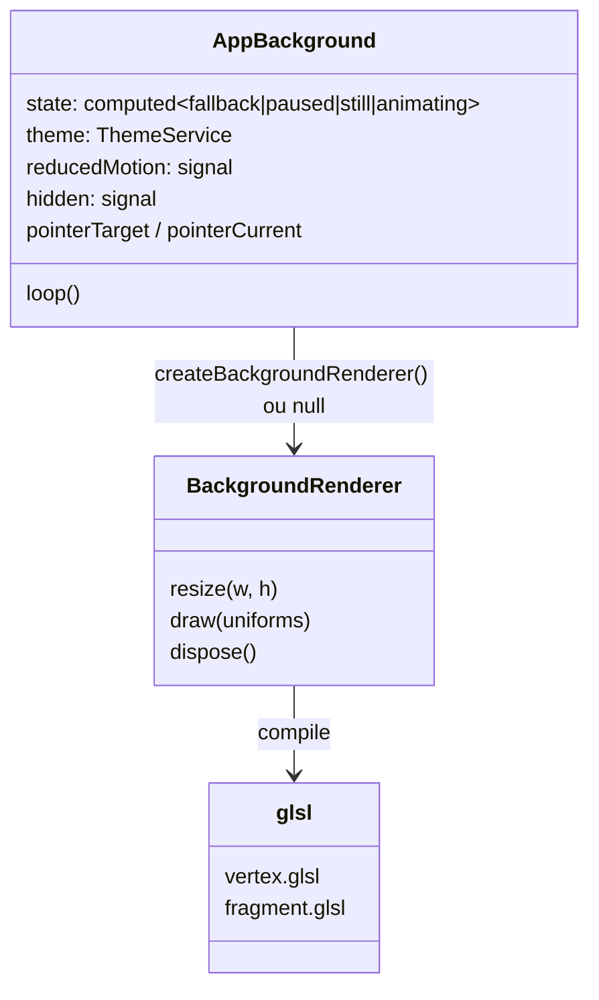
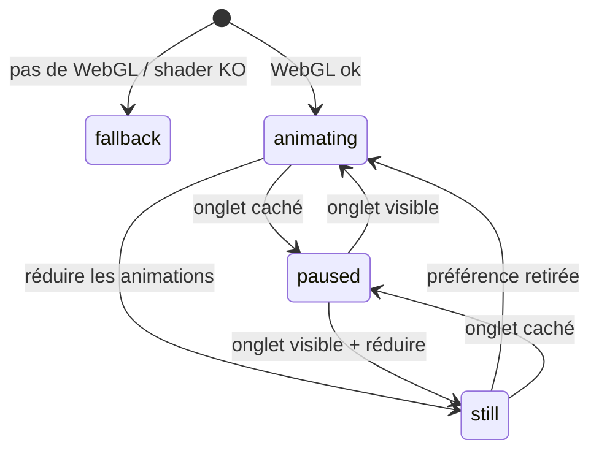

# 013 — Plan

Supprimé à la livraison : reporter d'abord les décisions utiles dans `spec.md`.

## Approche

**Fond animé** (`src/app/layout/background/`), monté **une seule fois** dans `app.html`, derrière la barre latérale et les pages :

- **Responsabilité unique**, en trois parties :
  - `component.ts` (avec `template.html` et `template.scss`) décide **quand** dessiner : signaux, écouteurs, boucle `requestAnimationFrame`, attribut `data-state`.
  - `renderer.ts` (`BackgroundRenderer`) sait **comment** dessiner en WebGL (`resize`, `draw(uniforms)`, `dispose`), sans rien d'Angular.
  - `shaders/vertex.glsl` et `shaders/fragment.glsl` contiennent les shaders, importés comme du texte (`loader` `.glsl: text` dans `angular.json`, type déclaré dans `src/glsl.d.ts`).
- **Fonction fabrique** : `createBackgroundRenderer(canvas)` renvoie le moteur, ou `null` sans WebGL ou si le shader ne compile pas. `null` met l'état à `fallback` : le canvas est masqué et le dégradé CSS est posé sur l'hôte.
- **État calculé** : un `computed` déduit l'état de trois signaux (WebGL disponible, onglet caché, « réduire les animations »).
  - `animating` : la boucle tourne en continu, avec dérive, ondulation, pointeur lissé et fondu de thème de 300 ms.
  - `still` : une image est dessinée à chaque déplacement du pointeur ou changement de thème, avec le temps figé et sans lissage.
  - `paused` : rien n'est dessiné.
  - `fallback` : le dégradé CSS remplace le canvas.

  Un `effect` lance ou arrête la boucle selon l'état.
- **Signaux pour ce qui change rarement** :
  - `ThemeService.theme()` (existant) ;
  - `reducedMotion` (`matchMedia(...).addEventListener('change')`) ;
  - `hidden` (`visibilitychange`).

  Les écouteurs sont nettoyés à la destruction. **Le pointeur** est une simple variable, remplie par `pointermove` sur `window` (`passive`) et lue par la boucle : jusqu'à 120 événements par seconde ne déclenchent rien dans Angular. L'appli est zoneless, donc la boucle ne relance aucune détection de changements.
- **Canvas** : `position: fixed; inset: 0; z-index: -1`, `aria-hidden="true"`, `pointer-events: none`. Résolution plafonnée à `devicePixelRatio` 1,5, redimensionnement par `ResizeObserver`.

**Surfaces**, dans le mécanisme existant de `styles.css` (variables CSS et utilitaires `@theme`) :

- `--surface`, `--background` et `--popover` restent **opaques**. Les modals, les toasts et les menus déroulants (`bg-popover`) ne changent pas.
- `--card` devient **translucide** : cartes du Backlog et des Features, sans flou.
- Une nouvelle variable `--glass` et une classe `.glass` (surface `--glass`, `backdrop-filter: blur(18px)`) servent aux grands panneaux : barre latérale, barre mobile, lignes d'US du Sprint.
- Une classe `.page-header` (`.glass`, relief, marges, retour à la ligne) est posée sur l'en-tête existant de chaque page, comme `.select` et `.list-zone`.
- Les ombres claires et foncées deviennent semi-transparentes, pour se fondre sur le fond animé. En sombre, le reflet clair de `--neu-raised-sm` est renforcé.
- Les boutons `outline` et l'onglet actif passent de `bg-background` à `bg-transparent`, dans `libs/ui`. Dans un panneau translucide, ils prennent sa surface au lieu d'y faire une tache opaque.

**Écartés** :
- **Pattern State**, une classe par état : les états ne portent aucune logique propre.
- **Constructeur qui lève une exception** : l'absence de WebGL est un cas prévu, pas une erreur.
- **Composant `app-page-header`** : il n'aurait aucune logique, une classe CSS suffit.
- **Flou partout** : trop coûteux sur un fond redessiné à chaque image, avec des dizaines de cartes.
- **Surcouches translucides** : elles nuisent à la lisibilité des formulaires.
- **Un signal par mouvement du pointeur** : trop fréquent, sans rien à afficher dans Angular.
- **Une bibliothèque 3D** comme Three.js : une nouvelle dépendance pour un seul quad plein écran, alors que WebGL brut tient en une centaine de lignes.

Déjà en place, donc sans tâche de code (seulement vérifiés par les tests) : le contenu est centré (`mx-auto max-w-7xl` dans `app.html`), et les badges sont en relief (`shadow-raised-sm` dans `hlmBadge`).

## Impacts

- **Base** : aucun.
- **API** : aucune.
- **Contrats** : aucun.
- **Front** :
  - nouveau composant `layout/background/`, avec ses shaders `.glsl` ;
  - `angular.json` (`loader` `.glsl: text`), `tsconfig.json` et `src/glsl.d.ts` (type des imports `.glsl`) ;
  - `app.html` : fond monté, en-tête réservé au mobile ;
  - `layout/sidebar/` : bouton de repli, bouton de thème, dépoli ;
  - `layout/header/` : barre mobile avec le seul bouton menu ;
  - `styles.css` : variables, `.glass` et `.page-header` ;
  - `libs/ui` : bouton `outline` et onglet actif ;
  - en-têtes des pages Backlog, Features, Planning et Sprint ;
  - lignes et colonnes du Sprint ;
  - tests e2e : `layout/style.spec.ts` et un nouveau `layout/background.spec.ts`.

## Tâches

Courtes, dans l'ordre : le code s'arrête après chaque tâche pour validation.

- [x] **T1 — Variables de surface** : dans `styles.css`, `--card` et `--glass` translucides, classes `.glass` et `.page-header`, ombres semi-transparentes et reflet sombre renforcé. Boutons `outline` et onglet actif en `bg-transparent` (`libs/ui/button`, `libs/ui/tabs`). Sans fond animé, l'appli ne change presque pas, puisque la surface translucide repose encore sur un fond de même couleur.
  → vérif : `just tests --front` (build et non-régression).
  → à regarder : le diff de `styles.css`, puis l'appli en clair et en sombre, qui doit être quasi identique.
- [x] **T2 — Moteur WebGL** : `layout/background/shaders/vertex.glsl` et `shaders/fragment.glsl` (shaders importés comme du texte) et `renderer.ts` (`BackgroundRenderer`, `createBackgroundRenderer`), sans Angular et pas encore monté.
  → vérif : build (`just tests --front`).
  → à regarder : `renderer.ts` et `shader.ts`.
- [x] **T3 — Fond animé dans l'appli** : composant `AppBackground` (`component.ts`, `template.html`, `template.scss`), monté dans `app.html`. Il gère l'état `animating`, le suivi lissé du pointeur, l'état `still` (« réduire les animations », suivi en direct) et le repli CSS. Le fond se voit derrière les pages. Les tests e2e coupent WebGL par défaut (option `webgl` dans `tests/e2e/helpers.ts`) : sans GPU, le fond calculé par le processeur ralentissait tous les tests (×3 à ×5).
  → vérif : build et parcours navigateur.
  → à regarder : n'importe quelle page en clair et en sombre (fond animé, halos qui suivent la souris).
- [x] **T4 — États du fond** : `computed` de l'état (`animating`, `still`, `paused`, `fallback`), signal `hidden`, fondu de thème de 300 ms, attribut `data-state`.
  → vérif : build et parcours navigateur (« réduire les animations » émulé dans DevTools, onglet caché).
  → à regarder : `data-state` dans DevTools, qui change selon ces cas.
- [x] **T5 — Tests du fond** : nouveau `tests/e2e/layout/background.spec.ts`, avec `test.use({ webgl: true })` (sauf R77).
  - R76 : `reducedMotion: 'reduce'` donne `still`.
  - R77 : `getContext` neutralisé par un script d'initialisation donne `fallback`, sans erreur console.
  - R78 : `aria-hidden`, pas de focus, clic qui traverse.
  - R79 : `visibilitychange` simulé donne `paused`, puis `animating`.
  - R75 (suivi du pointeur) reste un contrôle visuel.

  → vérif : `just tests --front --grep "R7[6-9]"`.
  → à regarder : le fichier de tests.
- [x] **T6 — Barre latérale et barre mobile** :
  - barre latérale en `.glass` ;
  - bouton de repli à côté du titre, sous le logo quand elle est repliée (« Réduire le menu » / « Déplier le menu ») ;
  - sur mobile, ce même bouton ferme la barre ;
  - bouton de thème tout en bas (soleil en sombre, lune en clair) ;
  - `app-header` devient la barre mobile (`lg:hidden`, `.glass`, collante) avec le seul bouton menu ;
  - plus d'en-tête sur grand écran.

  → vérif : build et parcours navigateur, grand écran et mobile.
  → à regarder : replier et déplier, ouvrir sur mobile, changer de thème depuis le bas de la barre.
- [x] **T7 — Tests de la barre** : mise à jour de `tests/e2e/layout/style.spec.ts`. R40, R41 et R42 suivent les nouveaux boutons et libellés, R43 trouve le bouton de thème dans la barre, et un nouveau R80 vérifie l'icône soleil ou lune et le choix conservé.
  → vérif : `just tests --front --grep "R4[0-3]|R80"`.
  → à regarder : le diff des tests.
- [ ] **T8 — En-têtes de page et Sprint** : `.page-header` sur les en-têtes de Backlog, Features, Planning et Sprint. Sur le Sprint, les lignes d'US passent de `bg-card` à `.glass` et les colonnes de `bg-muted` (opaque) à une surface translucide sans flou.
  → vérif : build et parcours navigateur des quatre pages.
  → à regarder : aucun bouton ni champ posé directement sur le fond, et « Clôturer le sprint » en relief, en clair et en sombre.
- [ ] **T9 — Tests des surfaces** :
  - R81 : chaque en-tête de page est un `.page-header` qui contient les commandes de la page.
  - R82 : badges et boutons en relief (`box-shadow` non vide), sans bordure.
  - R83 : contenu centré, barre dépliée puis repliée.
  - R84 : modal et toast opaques (alpha de `background-color` à 1).

  → vérif : `just tests --front` (suite complète).
  → à regarder : le fichier de tests et le rapport.
- [ ] **T10 — Docs** :
  - `cahier-de-recettes.md` : R40, R41, R42 et R64 modifiées, R75 à R84 ajoutées, R71 rejouée ;
  - spec 012 : note sur les deux règles remplacées par la 013 ;
  - `docs/specs/README.md` : statut de la 013 ;
  - `idee-projet.md`, si le style y est décrit.

  → vérif : relecture.
  → à regarder : les diffs de `docs/`.
